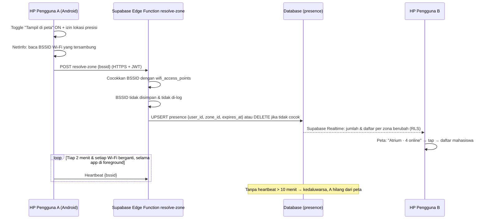

# Product Requirements Document (PRD) — AyoMatch

> Versi: 1.3 — 29 September 2026
> Untuk: Hackathon JOINTS UGM 2026 (FMIPA UGM), track **Healthcare** dengan sentuhan **Education**

Dokumen pelengkap: [README.md](./README.md) (latar belakang & fitur), [ARCHITECTURE.md](./ARCHITECTURE.md) (arsitektur & data model), [ROADMAP.md](./ROADMAP.md) (timeline), [CLAUDE.md](./CLAUDE.md) (konvensi kerja AI assistant).

### Riwayat Perubahan

| Versi | Tanggal | Perubahan |
|---|---|---|
| 1.0 | 25 Sep 2026 | Versi awal |
| 1.1 | 28 Sep 2026 | Match Map beralih dari grid koordinat ke zona bernama. Tambah bagian deteksi lokasi & integrasi Wi-Fi kampus. |
| 1.2 | 28 Sep 2026 | Tab Study & Competitions, data model sesi/lowongan, keputusan visibilitas timbal balik & zona kosong. |
| 1.3 | 29 Sep 2026 | **Pivot ke aplikasi native React Native (Expo), Android dulu.** Lokasi **hanya dari access point Wi-Fi (BSSID)** — QR, GPS, dan cek IP dihapus. Study & Competitions pindah ke tab **Match** (sub-tab Belajar & Lomba). Tab **Event** baru untuk acara di luar kampus, hanya dibuat kurator, **masuk scope MVP**. Strategi demo pakai hotspot. Tabel MVP ditulis ulang. |

---

## 1. Latar Belakang & Masalah

Interaksi dengan teman sebaya berkontribusi besar terhadap kemampuan kognitif dan rasa percaya diri mahasiswa. Namun kelompok sebaya cenderung eksklusif, sehingga mahasiswa yang gagal menemukan "teman sefrekuensi" berisiko terisolasi secara sosial.

Data I-NAMHS: 1 dari 3 remaja Indonesia (34,9%, ±15,5 juta jiwa) punya masalah kesehatan mental, dan sebagian besar melaporkan gangguan tersebut merusak kemampuan mereka berhubungan dengan teman sebaya (41,1%) dan berfungsi di sekolah/kampus (39,3%).

**Masalah inti**: tidak ada cara sistematis bagi mahasiswa baru/introvert/pindahan untuk menemukan partner belajar atau teman yang cocok secara gaya belajar, kepribadian, dan minat — mereka bergantung pada pertemuan kebetulan.

## 2. Solusi & Tujuan Produk

**AyoMatch** adalah **aplikasi mobile native (React Native + Expo), Android lebih dulu**, yang mempertemukan mahasiswa dalam satu kampus berdasarkan gaya belajar, kepribadian, dan minat — di dalam kampus lewat **Match** (belajar & lomba) dan **Match Map** berbasis Wi-Fi kampus, dan di luar kampus lewat **Event** yang dikurasi.

Alasan memilih native: hanya aplikasi native yang bisa membaca access point Wi-Fi yang sedang tersambung (BSSID), dan itulah dasar deteksi lokasi per ruangan tanpa GPS (§7).

### Tujuan (Goals)

1. Memutus siklus isolasi ↔ kerusakan kesehatan mental dengan mempertemukan mahasiswa secara proaktif, bukan menunggu "kebetulan".
2. Memvalidasi bahwa matching berbasis kepribadian & gaya belajar bisa mendorong pembentukan kelompok belajar baru dan pertemanan di luar kelas.
3. Menyediakan MVP yang bisa didemokan penuh di HP Android (bukan mockup) pada Grand Final, dengan fondasi data model yang extensible untuk fitur match lain.

### Non-Goals (MVP ini)

- Bukan aplikasi kencan/dating.
- **Bukan aplikasi iOS** di MVP. Membaca BSSID di iOS butuh entitlement *Access Wi-Fi Information* dan kemungkinan akun Apple Developer berbayar — ditunda.
- Tidak memakai GPS, QR check-in, atau cek IP untuk lokasi. **Satu-satunya sumber lokasi adalah access point Wi-Fi kampus.**
- Tidak ada fitur pembayaran di aplikasi. Event berbayar dibayar langsung di tempat.
- Pengguna biasa **tidak bisa** membuat Event (luar kampus). Hanya akun kurator.
- Sport Match, Gaming Match, Art Match, Organisation Match **tidak** diimplementasikan penuh — hanya disiapkan strukturnya.
- Tab Lomba bukan matching otomatis anggota tim berdasarkan skill dan bukan platform pendaftaran lomba — hanya lowongan anggota tim + permintaan bergabung.
- Bukan model klasifikasi kepribadian berbasis ML — cukup rule/skor sederhana dari kuis.
- Tidak melacak lokasi di background dan tidak menyimpan riwayat pergerakan pengguna.

## 3. Target Pengguna

| Persona | Kebutuhan |
|---|---|
| Mahasiswa baru/pindahan | Cepat kenal lingkungan kampus, cari teman & partner belajar sejak awal semester |
| Mahasiswa introvert/kesulitan bersosialisasi | Cara berinteraksi yang terstruktur & tidak mengintimidasi — termasuk datang ke acara tanpa harus sendirian |
| Mahasiswa yang butuh partner belajar/lomba spesifik | Cocok berdasarkan mata kuliah, gaya belajar, jadwal, atau peran tim |
| Mahasiswa yang ingin menjaga privasi lokasi | Tetap bisa terhubung lewat Match Map yang hanya menampilkan **nama ruangan** (misalnya "Atrium"), bukan titik koordinat |
| **Kurator** (tim AyoMatch, UKM, kafe/komunitas mitra) | Membuat dan mengelola Event di luar kampus yang aman dan relevan untuk mahasiswa |

Batasan akses: hanya mahasiswa dengan email institusi kampus (domain di-allowlist). Kurator juga harus punya akun terverifikasi dengan role `curator` yang diberikan admin.

## 4. Struktur Navigasi

Bottom navigation: **Beranda · Match · Event · Peta · Profil**

| Tab | Isi |
|---|---|
| Beranda | Ringkasan: badge kepribadian, rekomendasi teman, sesi terdekat, event pilihan |
| Match | Dua sub-tab: **Belajar** (Study Match — rekomendasi partner + sesi belajar) dan **Lomba** (Competition Match — lowongan anggota tim) |
| Event | Acara **di luar kampus** yang dikurasi (nongkrong, hobi, event langka bulanan, acara mitra) |
| Peta | Match Map: siapa yang online per ruangan, berdasarkan access point Wi-Fi kampus |
| Profil | Profil, hasil kuis, statistik, pengaturan privasi |

## 5. Scope MVP

Semua fitur di tabel ini **masuk scope hackathon**. Prioritas menentukan urutan pengerjaan: Must-have harus selesai dan stabil sebelum Should-have dikerjakan.

| # | Fitur | Deskripsi | Prioritas |
|---|---|---|---|
| 1 | Login kampus | Email institusi (domain allowlist), login via kode OTP 6 digit | Must-have |
| 2 | Kuis kepribadian | Onboarding quiz 6 pertanyaan, wajib sebelum masuk Beranda → klasifikasi rule-based | Must-have |
| 3 | Match › Belajar (Study Match) | Rekomendasi partner belajar (skor kecocokan) + buat/gabung sesi belajar di zona kampus | Must-have |
| 4 | Match Map via Wi-Fi | Zona ditentukan dari BSSID access point yang tersambung; peta skematis per gedung/ruangan; visibilitas timbal balik. Detail §7 | Must-have (inti inovasi) |
| 5 | Mode admin: daftarkan Wi-Fi | Layar khusus admin untuk mendaftarkan BSSID yang sedang tersambung ke sebuah zona — dipakai untuk survei AP dan demo hotspot | Must-have (syarat demo) |
| 6 | Event luar kampus (kurasi) | Daftar event, detail, RSVP dengan kuota, pengingat, form buat event khusus kurator. Detail §9 | Should-have |
| 7 | Match › Lomba (Competition Match) | Lowongan anggota tim lomba + permintaan bergabung yang disetujui pembuat. Detail §8 | Should-have |
| 8 | Add Friend & Chat | Tambah teman, chat privat/grup realtime | Should-have |
| 9 | View Profile | Lihat profil & hasil kepribadian pengguna lain | Should-have |
| 10 | Report & Moderasi | Lapor pengguna/event → `pending_review` → tinjauan manual → banned jika terverifikasi | Should-have |
| 11 | Meja Kecil (Event) | Sistem membagi peserta RSVP menjadi grup 4–6 orang berdasarkan kepribadian | Could-have |
| 12 | "Mau ketemu lagi?" | Setelah event, peserta memilih siapa yang ingin ditemui lagi; jika saling pilih → otomatis berteman | Could-have |

## 6. User Stories (Ringkas)

- Sebagai mahasiswa baru, saya ingin login dengan email kampus saya agar hanya sesama mahasiswa yang bisa mengakses aplikasi ini.
- Sebagai pengguna baru, saya ingin mengisi kuis kepribadian singkat agar sistem tahu gaya belajar saya sebelum mulai mencari match.
- Sebagai mahasiswa yang kesulitan di mata kuliah tertentu, saya ingin dicocokkan dengan mahasiswa lain yang mengambil mata kuliah sama dan gaya belajarnya cocok.
- Sebagai host belajar kelompok, saya ingin membuat sesi belajar dengan waktu, ruangan, dan kuota agar orang yang tepat bisa bergabung.
- Sebagai peserta, saya ingin melihat sesi belajar per tanggal dan jam, beserta berapa teman saya yang sudah ikut.
- Sebagai mahasiswa yang ikut lomba, saya ingin memasang lowongan anggota tim dengan peran yang saya butuhkan.
- Sebagai peserta, saya ingin melihat mahasiswa lain yang sedang online di ruangan yang sama (misalnya "Atrium") tanpa membagikan titik lokasi saya.
- Sebagai pengguna, saya ingin memilih sendiri kapan lokasi saya terlihat, dan status saya hilang otomatis saat saya berhenti memakai aplikasi.
- Sebagai mahasiswa introvert, saya ingin ikut acara di luar kampus yang aman dan dikurasi, dan tahu bahwa saya tidak akan datang sendirian.
- Sebagai kurator, saya ingin membuat event dengan tempat, waktu, kuota, dan perkiraan biaya agar mahasiswa bisa RSVP.
- Sebagai peserta event, saya ingin diingatkan sebelum acara dan bisa memilih siapa yang ingin saya temui lagi setelahnya.
- Sebagai pengguna, saya ingin melaporkan pengguna atau event yang tidak pantas dan yakin laporan saya ditinjau sebelum ada tindakan.

## 7. Deteksi Lokasi per Access Point Wi-Fi

### 7.1 Prinsip

1. **Zona, bukan koordinat.** Unit lokasi terkecil yang disimpan atau ditampilkan adalah **zona bernama** (contoh: "Atrium FMIPA", "Perpustakaan Lt. 2"), yang dipetakan dari satu atau beberapa access point.
2. **Satu sumber: access point Wi-Fi.** Aplikasi membaca BSSID dari Wi-Fi yang **sedang tersambung**. Tidak ada GPS, QR, atau cek IP.
3. **Tidak tersambung Wi-Fi kampus = tidak tampil.** Pengguna yang memakai data seluler atau Wi-Fi yang tidak terdaftar tidak muncul di Match Map (status "Kamu di luar jaringan kampus").
4. **Opt-in dan hanya saat aplikasi dibuka.** BSSID hanya dikirim saat toggle "Tampil di peta" aktif dan aplikasi di foreground. Tidak ada pelacakan di background.
5. **Kedaluwarsa otomatis.** Status kehadiran hilang setelah TTL 10 menit tanpa heartbeat.
6. **Tanpa riwayat.** Hanya status terkini per pengguna yang disimpan (satu baris, di-overwrite).
7. **Visibilitas timbal balik.** Pengguna yang tidak tampil juga tidak bisa melihat siapa yang online.
8. **Zona kosong tetap ditampilkan** dengan label "sepi".

### 7.2 Cara Kerja di Android

- BSSID dibaca lewat `@react-native-community/netinfo` (`details.bssid` saat tipe koneksi `wifi`).
- Android mewajibkan izin **lokasi presisi** (`ACCESS_FINE_LOCATION`) dan **layanan lokasi aktif** untuk membaca BSSID; tanpa itu nilainya `02:00:00:00:00:00`. Aplikasi harus menjelaskan ini saat meminta izin: izin lokasi dipakai **hanya** untuk membaca nama Wi-Fi, bukan GPS.
- Satu access point biasanya punya beberapa BSSID (per band 2,4 GHz / 5 GHz dan per SSID). Semua BSSID dari AP yang sama didaftarkan ke zona yang sama.
- Jangkauan AP bisa menembus ruangan sebelah, jadi presisi zona = jangkauan AP. Ini keterbatasan yang disampaikan transparan.
- Target minimum: Android 10 (API 29).

### 7.3 Pendaftaran Access Point (Mode Admin)

Tidak ada data AP dari IT kampus di MVP, jadi AP didaftarkan manual lewat survei:

1. Admin berjalan ke sebuah ruangan dengan HP tersambung ke Wi-Fi kampus.
2. Di layar **Daftarkan Wi-Fi**, aplikasi menampilkan BSSID saat ini; admin memilih zona (atau membuat zona baru) lalu menyimpan.
3. Ulangi untuk setiap AP/band di ruangan tersebut.

Pasca-hackathon: daftar AP bisa diminta resmi dari IT kampus, atau integrasi langsung dengan controller Wi-Fi kampus (lihat §7.7).

### 7.4 Urutan Penentuan Zona (Server)

1. Pengguna opt-in dan terautentikasi → lanjut; jika tidak → tolak.
2. BSSID cocok di `wifi_access_points` → zona AP tersebut.
3. BSSID tidak dikenal atau tidak ada Wi-Fi → hapus baris `presence` pengguna → pengguna tidak tampil.

### 7.5 Alur End-to-End

### 7.6 Strategi Demo Grand Final (Hotspot)

Wi-Fi venue (FMIPA UGM) bukan Wi-Fi kampus tim, jadi demo memakai **hotspot sebagai "access point kampus"**:

- Satu perangkat khusus (HP ketiga atau laptop dengan data seluler) menyalakan hotspot. **Jangan pakai HP demo sendiri sebagai hotspot**: perangkat yang menjadi hotspot tidak tersambung ke AP mana pun, sehingga pemiliknya tidak akan muncul di zona.
- HP demo A dan B tersambung ke hotspot tersebut. Hotspot memberi akses internet ke Supabase.
- Pada hari H, admin membuka **Daftarkan Wi-Fi** di HP A dan mendaftarkan BSSID hotspot sebagai zona "Ruang Pitching". Daftarkan di hari yang sama karena beberapa HP Android mengacak alamat hotspot setiap kali hotspot dinyalakan ulang.
- Alur demo: A dan B menyalakan "Tampil di peta" → keduanya muncul di "Ruang Pitching · 2 online" → B mematikan Wi-Fi → B hilang dari peta.
- Cadangan jika internet venue/seluler bermasalah: laptop menjalankan Supabase lokal (Docker) dan menjadi hotspot; aplikasi demo diarahkan ke IP laptop.

### 7.7 Pasca-hackathon

- Dukungan iOS (entitlement *Access Wi-Fi Information*).
- Integrasi controller/RADIUS Wi-Fi kampus lewat MoU dengan IT kampus, sehingga daftar AP tidak perlu disurvei manual.

## 8. Tab Match: Belajar & Lomba

Tab Match punya dua sub-tab dengan satu tombol tambah yang labelnya menyesuaikan: **"Buat sesi"** di Belajar dan **"Cari anggota tim"** di Lomba.

| | Belajar (Study Match) | Lomba (Competition Match) |
|---|---|---|
| Tujuan | Sesi belajar bareng dalam waktu dekat di kampus | Mencari anggota tim untuk lomba |
| Pengelompokan | Strip tanggal + grup per jam | Grup per deadline pendaftaran |
| Filter | Mata kuliah, jenis sesi | Kategori lomba |
| Field wajib | Judul, mata kuliah, tanggal, jam, zona kampus, jenis (Kelompok / Tutor sebaya / Diskusi), kuota | Nama lomba, kategori, deadline, ukuran tim, anggota saat ini, peran yang dicari |
| Cara bergabung | Langsung, sampai kuota penuh | Permintaan → disetujui/ditolak pembuat |
| Hilang dari daftar | Setelah jam selesai | Setelah deadline lewat atau tim penuh |

Aturan: tempat sesi dipilih dari daftar zona (bukan teks bebas) sehingga sesi muncul di sheet zona pada Peta; pembuat otomatis jadi anggota pertama; sesi penuh tetap tampil dengan status "Penuh".

## 9. Tab Event: Acara di Luar Kampus

### 9.1 Konsep

Match = akademik, di dalam kampus, bisa hari ini juga. **Event = sosial, di luar kampus, jarang dan terasa spesial.** Semua event **dikurasi**: hanya akun berperan `curator` yang bisa membuatnya.

### 9.2 Jenis Event di MVP

| Jenis | Contoh | Catatan |
|---|---|---|
| Event langka bulanan | Nobar final, trip pantai, workshop | Satu sorotan per bulan di bagian atas tab |
| Hobi | Lari pagi, badminton, board game, photowalk | Jembatan ke Sport/Gaming/Art Match |
| Dari mitra | Acara UKM, komunitas, kafe mitra | Menunjukkan model keberlanjutan (Dampak & Kelayakan) |
| Meja Kecil *(Could-have)* | Nongkrong grup 4–6 orang yang dicocokkan sistem | Peserta RSVP, lalu dibagi grup berdasarkan kepribadian H-1 |

### 9.3 Aturan

- **Tempat publik atau mitra terverifikasi saja**, tidak boleh alamat rumah. Kurator memilih venue dari daftar venue yang sudah disetujui admin.
- Kartu event menampilkan: kurator, judul, tanggal & jam, nama venue, perkiraan biaya ("Gratis" atau "± Rp35.000, bayar di tempat"), kuota, dan jumlah teman yang ikut.
- **RSVP dengan kuota**; jika penuh, pengguna masuk daftar tunggu dan naik otomatis saat ada yang batal.
- **Pengingat**: notifikasi lokal H-1 dan 3 jam sebelum acara, dengan tombol "Masih ikut / Batal". Tujuannya menekan no-show.
- **Keamanan**: tombol "Bagikan detail ke teman" (share sheet bawaan Android) dan tombol lapor event/peserta lewat alur moderasi yang sama.
- **Setelah acara** *(Could-have)*: "Mau ketemu lagi?" — peserta memilih siapa yang ingin ditemui lagi; jika saling memilih, otomatis berteman. Pilihan yang tidak berbalas tidak pernah ditampilkan ke pihak lain.

## 10. Requirement Non-Fungsional

- **Privasi lokasi**: BSSID yang dikirim HP pengguna **tidak disimpan** dan **tidak di-log**; server hanya menyimpan `zone_id` terkini dengan TTL. Pengguna lain hanya menerima nama zona dan jumlah/daftar yang opt-in. Non-negotiable, lihat [ARCHITECTURE.md §6](./ARCHITECTURE.md).
- **Persetujuan eksplisit**: fitur lokasi default **off**, izin lokasi presisi diminta dengan penjelasan bahwa izin itu hanya untuk membaca Wi-Fi. Pengguna bisa mematikan kapan saja dan status langsung dihapus. Sejalan dengan UU No. 27/2022 tentang Pelindungan Data Pribadi.
- **Keamanan data**: RLS aktif di semua tabel data personal (presence, hasil kepribadian, kontak, KTM, RSVP). Service role key Supabase hanya ada di Edge Function, tidak pernah di dalam aplikasi.
- **Autentikasi terbatas domain**: hanya email kampus yang di-allowlist.
- **Role**: `student` (default), `curator` (buat event), `admin` (daftarkan Wi-Fi, beri role kurator, moderasi). Pengecekan role di RLS dan Edge Function, bukan hanya di UI.
- **Moderasi bertahap**: `pending_review` sebelum `banned`, tidak ada auto-ban dari satu laporan.
- **Platform**: Android 10+, distribusi APK untuk demo.
- **Availability saat demo**: fallback Supabase lokal di laptop (§7.6).
- **Rate limiting**: lapor, kirim pesan, buat sesi/lowongan/event, `resolve-zone`.
- **Hemat baterai**: heartbeat lokasi maksimal tiap 2 menit dan saat Wi-Fi berganti, hanya di foreground.

## 11. Metrik Keberhasilan

Untuk hackathon: Inovasi (25%), Implementasi Teknis (30%), Fungsionalitas & Desain (20%), Dampak & Kelayakan (15%), Presentasi (10%). Demo end-to-end di HP Android tanpa error kritis: login → kuis → Match Belajar (buat/gabung sesi) → Peta via hotspot → (jika sempat) Event RSVP, Lomba, chat.

Untuk validasi produk (indikatif):

- Jumlah sesi belajar yang dibuat & diikuti.
- Tingkat penyelesaian kuis onboarding.
- Persentase pengguna yang mengaktifkan Match Map.
- Tingkat kehadiran event (RSVP yang tidak batal) dan persentase "Mau ketemu lagi?" yang saling memilih.
- Jumlah tim lomba yang terisi penuh.
- Jumlah pertemanan baru yang terbentuk.

## 12. Asumsi & Batasan (Constraints)

- Tim 4 orang. Sisa waktu efektif ±17 hari (29 Sep – 16 Okt 2026).
- **Risiko terbesar**: pivot dari Next.js ke React Native di tengah jalan. Anggota tim yang belum pernah memakai React Native butuh waktu adaptasi (navigasi, build Android, izin). Must-have harus dikunci dulu sebelum menyentuh Should-have.
- Tech stack: Expo (React Native) + TypeScript, Supabase. Lihat [CLAUDE.md](./CLAUDE.md).
- Android saja; iOS pasca-hackathon.
- Daftar access point didapat dari survei manual; presisi zona sama dengan jangkauan access point.
- Klasifikasi kepribadian berbasis rule/skor sederhana, bukan ML.
- Supabase free tier — perhatikan batas koneksi Realtime saat Grand Final.

## 13. Timeline Acuan

Lihat [ROADMAP.md](./ROADMAP.md). Milestone kunci:

| Tahap | Tanggal |
|---|---|
| Pengumpulan deliverables (kode, video demo, pitch deck, prototype) | 15–16 Oktober 2026, 23.50 WIB |
| Pengumuman finalis | 23 Oktober 2026 |
| Grand Final (pitching di FMIPA UGM) | 1 November 2026 |

## 14. Open Questions

- Sumber pertanyaan kuis kepribadian & bobot skoringnya.
- Kampus mana yang dipakai untuk survei access point, dan ruangan apa saja yang jadi zona awal.
- Siapa saja kurator awal (tim AyoMatch saja, atau langsung menggandeng UKM/kafe mitra)?
- Daftar venue awal yang disetujui untuk Event.
- Apakah Meja Kecil perlu opsi grup sesama gender untuk rasa aman?
- Daftar mata kuliah untuk sesi belajar: seed manual atau data kurikulum kampus?
- Apakah lowongan tim Lomba wajib menyertakan link guidebook untuk mencegah spam?
- Apakah zona dengan hanya 1 orang online tetap ditampilkan?
- Kebijakan retensi data setelah lomba selesai.
